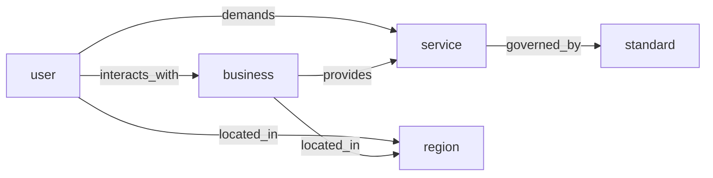

# HRET

**Heterogeneous Information Network for Recommendation in Testing and Inspection**

Reference implementation of the HRET pipeline described in the ICSS 2022 paper by
Liwen Zhang, Weiping Li, Tong Mo and Weijie Chu. See
[`docs/paper.md`](docs/paper.md) for the paper record and scope notes.

[](https://doi.org/10.1109/ICSS55994.2022.00038)
[](https://www.python.org/)
[](LICENSE)

> **中文简介**：HRET 面向检验检测（testing and inspection）场景，把企业用户、检测机构、
> 检测服务、标准与地域建模为异质信息网络（HIN），通过元路径随机游走与 metapath2vec
> 学习节点表示，再用元路径注意力融合用户/机构的多个语义视图，最后以 BPR 排序损失
> 完成"用户—检测机构"的 Top-N 推荐。仓库包含完整的数据处理、预训练、训练、评测、
> 基线对比与单元测试。

---

## 1. Why HRET?

Testing and inspection is a traditional industry where recommendation still largely relies
on similarity-based collaborative filtering. Such models use only the user–business
interaction matrix and ignore the rich auxiliary structure that already exists in the
domain: which inspection services a business is accredited for, which standards those
services implement, and where the user and the business are located. HRET turns this
auxiliary structure into a heterogeneous information network and learns representations
that respect the semantics of different meta-paths.

## 2. Heterogeneous information network schema

| Node type | Meaning |
| --- | --- |
| `user` | Enterprise or organisation that requests an inspection |
| `business` | Testing and inspection service provider |
| `service` | Concrete inspection item (e.g. material analysis) |
| `standard` | Standard the service is accredited against |
| `region` | Administrative region of a user or a business |



Symmetric meta-paths used by the reference configuration:

| Name | Path | Captures |
| --- | --- | --- |
| `UBU` | user → business → user | users sharing a provider |
| `USU` | user → service → user | users with the same inspection demand |
| `URU` | user → region → user | regional homophily |
| `BUB` | business → user → business | providers serving the same clients |
| `BSB` | business → service → business | providers with overlapping accreditation |

The registry also contains `USBU` and `BSUB`; arbitrary dash-separated paths such as
`user-service-business-user` are accepted as long as they start and end with the same
node type.

## 3. Method

```text
                meta-path walks                metapath2vec
   HIN  ───────────────────────────►  typed  ───────────────►  per-path
        (UBU, USU, URU, BUB, BSB)     walks                   embeddings
                                                                    │
                                                                    ▼
   user/business representation  ◄──── meta-path attention fusion ──┘
                │
                ▼
        BPR ranking  ──►  Top-N businesses
```

1. **Meta-path guided walks.** Starting from every node of the path's centre type, a walk
   follows the type schema and samples a neighbour of the required type at every step.
2. **metapath2vec.** Each walk is split into per-node-type sequences and a skip-gram model
   with negative sampling is trained on them. This yields one embedding table per
   `(meta-path, node type)` pair.
3. **Meta-path attention fusion.** A node has several views (one per meta-path). HRET
   learns a soft weight for each view instead of concatenating them:

   ```text
   q     = W_q · mean_i(e_i)
   α_i   = softmax_i( qᵀ W_k e_i / √d )
   h     = LayerNorm( Σ_i α_i · W_v e_i + mean_i(e_i) )
   ```

4. **Ranking.** Businesses are scored against a user with a dot product or a small MLP,
   and the model is optimised with Bayesian Personalised Ranking:

   ```text
   L_BPR = - mean log σ( s(u, b⁺) - s(u, b⁻) ) + λ‖Θ‖²
   ```

See [`docs/model.md`](docs/model.md) for the full derivation and implementation notes, and
[`docs/paper.md`](docs/paper.md) for the paper record, abstract and scope notes.

## 4. Repository layout

```text
HRET/
├── configs/hret.yaml            # single source of truth for an experiment
├── data/sample/                 # small synthetic dataset (committed)
├── docs/                        # paper notes, model and dataset documentation
├── hret/
│   ├── baselines.py             # popularity and BPR-MF baselines
│   ├── config.py                # typed configuration
│   ├── data/                    # loading, HIN construction, meta-path walks
│   ├── evaluation.py            # HR@K, NDCG@K, MRR
│   ├── models/                  # metapath2vec, attention fusion, HRET
│   ├── runner.py                # end-to-end experiment orchestration
│   ├── training/trainer.py      # BPR training with early stopping
│   └── utils.py
├── scripts/                     # train / evaluate / benchmark / data generation
├── tests/                       # unit and end-to-end tests
├── Makefile
└── pyproject.toml
```

## 5. Quickstart

```bash
python -m venv .venv
source .venv/bin/activate
pip install -e ".[dev]"

# 1. (optional) regenerate the synthetic sample
python scripts/generate_synthetic.py --out data/sample

# 2. train HRET
python scripts/train.py --config configs/hret.yaml --output runs/hret

# 3. evaluate the checkpoint
python scripts/evaluate.py --checkpoint runs/hret/hret.pt

# 4. compare with popularity and BPR-MF
python scripts/benchmark.py --config configs/hret.yaml --output runs/benchmark

# 5. tests
pytest -m "not slow"
```

A CPU-only run on the bundled sample finishes in a couple of minutes. `--device cuda`
switches to a GPU if one is available.

## 6. Data format

```
data/<dataset>/
├── users.csv              user_id,region[,industry]
├── businesses.csv         business_id,region
├── services.csv           service_id,category,standard_id
├── business_services.csv  business_id,service_id
└── interactions.csv       user_id,business_id,service_id,timestamp
```

Example:

```csv
user_id,business_id,service_id,timestamp
U0000,B0044,S0002,20220105
U0000,B0052,S0006,20220113
```

Only the columns above are required. See [`docs/dataset.md`](docs/dataset.md) for the
split protocol, cold-start behaviour and instructions for plugging in a private dataset.
The bundled `data/sample` is **synthetic**; it is generated with a latent category and
region preference and is intended for smoke tests and tutorials, not for reporting
scientific results.

## 7. Configuration

Everything is driven by [`configs/hret.yaml`](configs/hret.yaml); overrides work from the
command line:

```bash
python scripts/train.py --config configs/hret.yaml \
    --set model.dim=128 train.epochs=60 model.meta_paths='[UBU, USU, BUB, BSB]'
```

| Key | Default | Description |
| --- | --- | --- |
| `model.dim` | 64 | Embedding size |
| `model.meta_paths` | `[UBU, USU, URU, BUB, BSB]` | Meta-paths used for the user/business views |
| `model.walks_per_node` | 8 | Walks started from each centre node |
| `model.walk_length` | 30 | Nodes per walk (the schema repeats after the first cycle) |
| `model.window_size` | 3 | Skip-gram context window |
| `model.pretrain_epochs` | 5 | metapath2vec epochs |
| `model.scorer` | `mlp` | `mlp` or `dot` |
| `model.fusion` | `attention` | `attention`, `concat`, `hybrid` or `mean` |
| `model.use_id_embedding` | `false` | Add a BPR-MF style residual id view |
| `model.use_bias` | `false` | Add user / business bias terms |
| `data.split_strategy` | `random` | `random` or `temporal` leave-one-out |
| `train.epochs` | 40 | Maximum BPR epochs |
| `train.patience` | 10 | Early-stopping patience on validation NDCG |
| `evaluation.ks` | `[5, 10]` | Cut-offs for HR and NDCG |

## 8. Evaluation protocol

* Leave-one-out per user on **distinct businesses**: one business is held out for
  validation and another for test, the rest is training data. By default the held-out
  businesses are sampled uniformly (`data.split_strategy: random`); set
  `data.split_strategy: temporal` to hold out the two latest interactions instead.
* At validation time the training items are masked; at test time both training and
  validation items are masked.
* Ranking is computed over the full business catalogue (or a sampled candidate pool when
  `evaluation.candidate_pool > 0`).
* Metrics: `HR@K`, `NDCG@K` and `MRR`.

## 9. Results

The paper reports experiments on a real-world testing-and-inspection dataset. That
dataset is not redistributed here. To reproduce the comparison on your own data, run:

```bash
python scripts/benchmark.py --config configs/hret.yaml --output runs/benchmark \
    --seeds 42 7 2024
```

The script writes `runs/benchmark/benchmark_summary.json` with validation and test
metrics for Popularity, BPR-MF and HRET, and prints a summary table. A reference run on the
**synthetic** sample (not the paper's data):

| Model | HR@5 | HR@10 | NDCG@5 | NDCG@10 | MRR |
| --- | ---: | ---: | ---: | ---: | ---: |
| Popularity | 10.28 ± 1.71 | 18.06 ± 0.52 | 5.86 ± 1.12 | 8.35 ± 0.72 | 8.24 ± 1.00 |
| BPR-MF | 9.03 ± 3.61 | 17.78 ± 3.94 | 5.23 ± 1.96 | 8.01 ± 2.05 | 7.96 ± 1.35 |
| **HRET** | **12.08 ± 1.80** | **23.61 ± 2.39** | **7.41 ± 0.65** | **11.14 ± 0.68** | **10.41 ± 0.23** |

Percentages (mean ± population std) on the test split over seeds 42, 7 and 2024 on the
bundled synthetic sample. These are **not** the paper's results.

Numbers from the synthetic set must not be compared with the paper's table.

## 10. Paper-to-code map

| Paper component | Implementation |
| --- | --- |
| HIN construction | [`hret/data/schema.py`](hret/data/schema.py), [`build_hin`](hret/data/dataset.py) |
| Meta-path definition and walks | [`hret/data/metapath.py`](hret/data/metapath.py) |
| metapath2vec | [`hret/models/metapath2vec.py`](hret/models/metapath2vec.py) |
| Meta-path attention fusion | [`hret/models/fusion.py`](hret/models/fusion.py) |
| HRET ranker | [`hret/models/hret.py`](hret/models/hret.py) |
| BPR training | [`hret/training/trainer.py`](hret/training/trainer.py) |
| Evaluation | [`hret/evaluation.py`](hret/evaluation.py) |
| Baselines | [`hret/baselines.py`](hret/baselines.py) |

## 11. Citation

```bibtex
@inproceedings{zhang2022hret,
  title     = {HRET: Heterogeneous Information Network for Recommendation in Testing and Inspection},
  author    = {Zhang, Liwen and Li, Weiping and Mo, Tong and Chu, Weijie},
  booktitle = {2022 International Conference on Service Science (ICSS)},
  pages     = {203--208},
  year      = {2022},
  doi       = {10.1109/ICSS55994.2022.00038}
}
```

## 12. License

Released under the [MIT License](LICENSE). The synthetic data is provided for
reproducibility of the code pipeline only.
